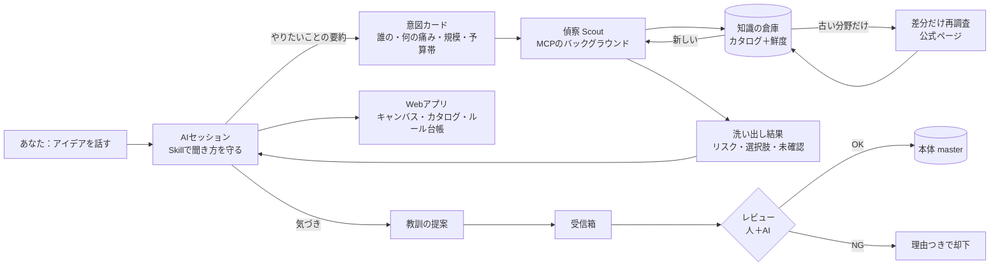

# Blueprint の届け方（どのAIセッションからでも呼び出す仕組み）
CREATIVITY IS EVERYWHERE, LLC ・ 2026-10-26 ・ 下書き（公開しない）

## 0. ひとことで
**「中身（知識と手順）は1つ、入口は複数」**にします。
- 中身＝**Blueprint の本体**（カタログ、ルール、手順）。1か所に置き、全部の入口から同じものを読む。
- 入口＝**Skill**（どのAIでも読める説明書）＋ **MCPサーバー**（最新の調査と記録をする“窓口”）。
- 見る場所＝**Webアプリ**（キャンバス・カタログ・ルール台帳を人が見て決める）。
- 配り方＝**プラグイン**（Skill と MCP をひとまとめにして、各AIツールに一発で入れる箱）。

## 1. 用語をやさしく
| 形 | たとえ | 何ができる | できないこと |
|---|---|---|---|
| **Skill（SKILL.md）** | 料理のレシピ本 | AIが読んで「こう考える・こう聞く・こう出す」を守る。ファイルだけなので軽い・無料 | 自分で最新情報を取りに行く、記録を残す、他のセッションと共有する |
| **MCPサーバー** | 電話で聞ける専門窓口 | AIが「Stripeの今の料金は？」「この教訓を送って」と道具として呼べる。最新化・記録・共有ができる | 置き場所（サーバー）と保守が要る。AIツール側の対応が要る |
| **プラグイン** | 家電の「同梱セット」 | Skill＋MCPの接続設定＋よく使う命令（/blueprint など）を1つの箱にして、Claude Code や Cursor に一回で入れる。中身はSkillとMCPそのもの | 新しい能力は増えない（まとめ方の話）。ツールごとに箱の形式が少し違う |
| **Webサービス／アプリ** | ショールーム | 人が見て、比べて、決める画面。キャンバス、カタログ、承認ボタン | AIのセッションの中には入れない（リンクやMCP経由で連携） |

## 2. 形ごとの比較
| | Skillだけ | MCPだけ | プラグイン（Skill＋MCP） | Webアプリだけ | **おすすめ：Skill＋MCP＋Webを1つの本体で** |
|---|---|---|---|---|---|
| 入れやすさ | ◎ ファイルを置くだけ | ○ 接続設定 | ◎ 一発（対応ツールで） | ◎ URLを開く | ○ |
| 対応AI | Claude Code／Codex（AGENTS.md）／Cursor（rules）／Grok Bot（skill）／ChatGPT（Project 指示） | Claude、Cursor、Codex、ChatGPT（コネクタ）、Grok Bot | Claude Code、Cursor など対応ツールのみ | 全部（人が見る） | 全部 |
| 最新化 | × 書いた時点で止まる | ◎ | ◎ | ◎ | ◎ |
| 教訓の自動送信 | × | ◎ | ◎ | △ 手で入力 | ◎ |
| 費用 | $0 | $0〜$5/月（Cloudflare Workers 無料枠〜$5） | 同左 | $0〜$20/月 | $5〜$25/月 |
| リスク | 古い情報を自信満々に使う | 外部窓口なので認証・悪用対策が必須。止まると全員困る | ツールの形式変更に追随が要る | セッションと分断される | 部品が増える（ただし本体は1つ） |
| 重さ | 読み込むと文脈を食う → **核だけ** | 必要な時だけ呼ぶので軽い | 同左 | — | 軽い |

**判断**：Skillは「考え方」を運ぶのに最適、MCPは「新しさ・記録・共有」を運ぶのに最適で、役割が違います。両方を持ち、MCPが使えない環境でもSkillだけで最低限動く（劣化モード）ようにします。プラグインは配布の手段として後から作る（中身を変えずに箱を足すだけ）。

## 3. 実行の流れ（話している裏で“偵察”が走る）

図：`delivery-architecture.png`

1. **最初の5分**：AIがSkillに従って「誰の、どんな困りごと、どれくらいの規模、予算帯（無料／$5／$10／$100）」を聞き、**意図カード**にまとめる。
2. **偵察（Scout）**：意図カードを受け取り、15分野（フロント、バックエンド、DB、認証、セキュリティ、ホスト、決済、保存、メール、分析、AI、検索、リアルタイム、CI/CD、監視）＋**作る／API／全部入り**の比較を、分野ごとに並行で洗い出す。会話は止めない。終わった分野から「こんなリスクがあります」を小出しにする。
3. **倉庫を先に見る**：分野ごとに鮮度を確認。新しければそのまま使う（速い・安い）。古ければ**変わったところだけ**公式ページで確認。
4. **結果**：リスク（例：Stripe Connect の責任の所在）、選択肢2〜3案と推し、未確認リスト。未確認は「未確認」と表示して、推測で埋めない。
5. **教訓**：使っている間に「これは想定外だった」が出たら、AIが自動で**提案**として送る（本体は直接書き換えない）。

## 4. 知識の倉庫：毎回調べる？ 貯める？ 差分？
**結論：貯める＋分野ごとの賞味期限＋差分だけ再調査。**
| 情報の種類 | 賞味期限（TTL） | 期限切れの時 |
|---|---|---|
| セキュリティ勧告・脆弱性 | **7日** | 毎回チェック（安い：勧告フィードを見るだけ） |
| 規制・法律（SMS登録、個人情報） | 30日 | 公式ページの変更点だけ |
| APIの仕様・対応状況（パスキー対応など） | **30日** | 変更履歴（changelog）だけ読む |
| 料金・無料枠 | **90日** | 料金ページを読み直し、差があれば更新 |
| 向き不向き・ロックイン・考え方 | 180日 | 半年ごとに見直し |
| 自分のプロジェクトの決定 | 期限なし | 変えた時だけ（理由を残す） |

- 差分の見つけ方：前回の**ページの指紋（ハッシュ）**と比べ、変わったページだけ読み直す。変わっていなければ「確認日」だけ更新。
- 11個目のプロジェクトでは、10個分の蓄積がそのまま使えます。11か月前の料金は「期限切れ」と表示し、使う前に自動で確かめます。

## 5. 頭を良くし続けつつ、重くしない
- **本体＝核（軽い）＋分野パック（必要な時だけ読む）**。核は「考え方・聞き方・ルール台帳・出力の形」だけ（目安：数千語以内）。分野パック（決済、認証、SMS…）は偵察が必要と判断した時だけ読む。
- **教訓の流れ**：提案 → 受信箱 → レビュー（AIが重複・根拠・矛盾をチェック、最後は人が承認）→ 本体へ。CHANGELOG に「いつ・何が・なぜ」を残す。
- **自動で投げる条件**（送りすぎ防止）：①公式の根拠がある、②既存の項目と重複しない、③プロジェクト固有の秘密（名前・金額・顧客）を含まない。満たさないものはそのプロジェクト内のメモにとどめる。
- **90日使われない項目**は「控え」に移して核を軽く保つ。

## 6. 安全
- MCPは読み取りと「提案の送信」だけ。本体の書き換えはレビュー経由のみ。
- 外部ページの中に書かれた「AIへの指示」は無視してデータとして扱う（料金ページに埋め込まれた例を確認済み）。
- 鍵は MCP 側に置き、AIセッションには渡さない。

## 7. 進め方（小さく）
1. いまの catalog/*.yaml＋ルール台帳を「本体」とし、**Skill（核）**を書く — $0
2. **MCP（読み取り＋鮮度チェック＋提案受付）**を Cloudflare Workers に — 無料〜$5/月
3. Webアプリ（今のキャンバスとカタログ）を本体につなぐ
4. 使い回しが3回を超えたら**プラグイン**にまとめて配る
