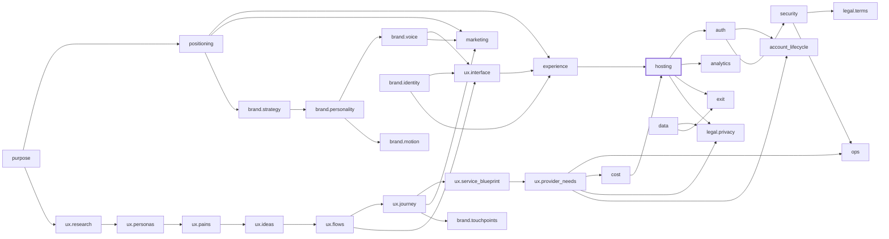

# Launch Blueprint v2

Purpose: see the whole project once, decide the expensive-to-change things up front, and make every later change show its ripple effects, so the project does not keep changing direction, stack, or host halfway through.

The owner asks about what is in front of them. This skill covers what they have not asked about yet, and only as deep as the project needs.

## 0. Intake first: set the depth (max 10 questions, one batch)

Ask these before anything else. Offer a recommended default answer for each so the owner can reply "defaults OK".

1. What is it, in one sentence, and who is it for?
2. Tier (pick one):
   - **T0 Sketch / prototype**: throwaway, no real users or data. Fill: Product, Experience, Stack (light), Cost cap. Skip everything else with `SKIPPED — T0`.
   - **T1 Internal / personal tool**: real data, known users only. Add: Data, Auth, Security, Ops, Exit. Skip marketing, public legal, most regulation.
   - **T2 Public product (free)**: strangers sign up. Everything except payments/tax; regulation by audience region.
   - **T3 Paid / regulated / minors / health / finance / AI decisions about people**: every block, plus lawyer review list.
3. Where are users (countries/regions) in the first 12 months? Any under 16 (under 13 in the US)?
4. Will it ever take money? When? (If "maybe later", plan the stack as if yes.)
5. Where should it be in 12 months: users, traffic, media (images/video/audio), AI usage?
6. What is already decided and not up for debate (brand, tools already paid for, host, language)?
7. Budget: monthly cash ceiling, and AI-credit budget per tool (which tool does heavy work, which is backup).
8. What is the single thing it must do well (the definition of done for v1)?
9. Content/positioning words to always use and never use.
10. Who approves what (publishing, sending, charging, deleting, merging)?

Rules: never ask more than 10; anything unanswered takes the stated default and is logged as an assumption. The tier can be raised later; raising it re-opens the skipped blocks. This prevents both blind spots and analysis paralysis.

## 1. Lock the "expensive-to-change" decisions (Decision Lock)

Before code, write a short Decision Lock: each item has the choice, one rejected option with reason, the trigger that would justify re-opening it, and the date.

- Host and runtime (decided for the 12-month shape, not for the fastest first deploy; commercial-use terms checked live)
- Framework and language; database and file/media storage
- Auth method and identity model (email, social, passkeys; one account = person or workspace)
- Domain and public URLs (no throwaway preview domains in anything public)
- Brand name, positioning sentence, banned words
- Design direction (pick from 2–3 options ONCE with the owner; record the pick)
- Payments provider / merchant of record (T3)
- Which AI tool does heavy work vs light fixes vs backup

Changing a locked item mid-project requires: impact list from the map (section 3), cost of the switch, and owner OK. No silent switches.

## 1.2 Day-1 gates from real projects (lessons learned; T1+ unless noted)

Every item below cost a real project days of rework. Each is a gate with a pass condition; unmet gates block the next phase.

| # | Gate | Pass condition | Feeds block |
|---|------|----------------|-------------|
| L1 | **Name + domain lock** (T0+) | Name chosen only after domain, trademark search and social handles are checked; domain registered to the company; no renaming without the change protocol | positioning, marketing |
| L2 | **Hosting decided for 12 months** | Cost ceiling computed at 0 / 100 / 10k users; free-tier limits and over-limit behavior listed with URL+date; tools already paid for checked first; one migration budgeted at most | hosting, cost |
| L3 | **Day-1 real-stack deploy spike** | A hello-world using the chosen framework + runtime + DB + auth is deployed on the real host on day 1 (framework/runtime fit proven before features) | hosting |
| L4 | **Demo vs real product** | Written answer: is this a demo, a prototype, or a sellable service? Separate branch/codebase or explicit "prototype will be rewritten"; preview DB strategy (no previews on production data) | scope, hosting, data |
| L5 | **Backup/restore gate** | Before any data-store change: export taken, restore tested on a copy, and a list of real users whose data must not be lost | data, exit |
| L6 | **Company identity before auth** | OAuth apps, sender names, store listings, and consent screens are created under the company (CREATIVITY IS EVERYWHERE, LLC or the project's company), never a personal name | auth, legal |
| L7 | **Email + DNS early** | Inbound and outbound email working with SPF/DKIM/DMARC before sign-up or contact forms ship | ops, auth |
| L8 | **Long-lead registrations on day 1** | Started day 1 with expected lead time: public business address, contact email, payment account, SMS A2P 10DLC, app-store accounts, legal pages | ops, legal |
| L9 | **Credentials checklist** | Per service: owner account, who has access, permissions/scopes, where the key lives, rotation date | security |
| L10 | **Secrets rules** | No secrets in chat, repos, logs, or screenshots; secret manager only; passwords never pasted to AI; card data only via the provider's secure form | security |
| L11 | **Admin excluded from public build** | Pre-deploy check proves admin routes/files are not in the public bundle; CDN cache purged after removal | security, ops |
| L12 | **Brand + real UI before landing page** | Brand direction, target and real product UI exist before the LP (no fake mock screens); motion ambition (none / subtle / showpiece) captured at kickoff | brand.identity, brand.motion, experience |
| L13 | **JTBD offer research** | Offer and pricing built from persona/JTBD/buying-psychology research and the buying experience, not from the maker's feature list; owner-pain/gain wording | positioning, ux.research |
| L14 | **Copy tone per language** | EN / ES / JA tone rules written; JA line breaks reviewed by eye (no orphaned particles); copy reviewed as text first | brand.voice, marketing |
| L15 | **Video pacing + checks** | Before production: scope, outcome, length, pacing (≥4 s per cut unless intended), script approved as text; AI art checked for anatomy errors; narration pronunciation verified (brand §7) | marketing, brand.voice_casting |
| L16 | **Paid-tool billing status** | Every paid tool (voice, video, hosting, AI) has its billing status checked before a job depends on it; failed renewals surfaced at once | cost |
| L17 | **AI-credit tracking** | Weekly table: tool, plan, used %, reset date, which tool does heavy vs light vs backup work | cost |
| L18 | **Shared-machine job queue** | Only one heavy job (build, render, large install) at a time on a shared machine; queue with owner and start time | ops |
| L19 | **Languages + feature flags** | Assume more languages than launch (i18n structure, not an EN/JA toggle); JA line-break rules (`word-break: auto-phrase` / `keep-all`) set; live feature flags listed and checked in production; embedding origins (`frame-ancestors`) decided | experience, hosting |
| L20 | **393px + design-system media** | Every page checked at 393px width (no 2-line headers/bars); all images, video and screenshots use design-system fonts/colors and are cropped at mobile width | brand.identity, experience |
| L21 | **Core message + exclusions** | One core sentence, what is deliberately left out, banned words, and per-channel language rules (e.g. which languages never go on which network) agreed with the owner before any content | positioning, marketing |
| L22 | **Script -> voice -> visuals** | Staged owner OK at each step; pronunciation dictionary (kana) before voice; STT diff vs script before the owner listens; captions max 2 lines (brand §7) | marketing, brand.voice_casting |
| L23 | **Host-move gate** (any host/DB/DNS move) | Tool versions verified (runtime e.g. Node 22 for wrangler; pg_dump >= server; monitor scripts check their commands exist); rehearsal on a copy with checksums + point-in-time bookmark (e.g. D1 Time Travel); read-only roles re-granted on new tables; build cache copy + smoke tests on the new host BEFORE DNS; wildcard + OAuth redirects ready beforehand; write-freeze flag deployed before cutover with announced window; MX/SPF/DKIM untouched; all DNS records (incl. apex CNAME) audited after the NS switch | hosting, data, exit, ops |

## 1.5 UX discovery (BEFORE any code; scaled by tier)

Owner-verifiable thinking, not a vibe. Each step writes a short artifact in `docs/blueprint/ux/` and is not "done" until its exit criteria are visibly met. Coding starts only after the tier's required steps pass (T0: steps 1, 3, 4, 9 in one page; T1: 1–5, 9; T2: all 9; T3: all 9 + research with real people). Unverified claims are marked `ASSUMPTION` and listed for the owner.

| # | Step | Artifact | Exit criteria (a human can check) |
|---|------|----------|-----------------------------------|
| 1 | Research | `research.md` | Problem stated in user words; ≥5 sources or interviews cited with links/dates; 3+ existing alternatives with what users like/hate; facts vs assumptions separated |
| 2 | Personas / JTBD | `personas.md` | 2–4 personas (1 primary), each tied to research evidence, with job-to-be-done ("when…, I want…, so I can…"), context (devices, place, time, ability), and a non-target persona |
| 3 | Pain points | `pains.md` | Pains ranked by frequency × severity, each with evidence; top 3 chosen and why others are out |
| 4 | Solution brainstorm | `ideas.md` | ≥3 genuinely different directions (incl. a non-software/manual one); scored on value, effort, risk; pick + rejected options with reasons |
| 5 | UX concept & user flows | `flows.md` (+Mermaid) | Concept in one paragraph; happy path + empty, error, offline, first-run, return-visit, cancel/delete flows; every step names the screen/channel |
| 6 | Customer journey map | `journey.md` | Stages aware → consider → start → use → get help → renew/leave; per stage: actions, thoughts, feelings, touchpoints, pains, opportunities |
| 7 | Service blueprint | `service-blueprint.md` | Rows: customer actions / frontstage (seen) / backstage (unseen staff or AI) / support processes & systems / evidence; lines of interaction, visibility, internal interaction; failure points and wait times marked |
| 8 | What the provider needs | `provider-needs.md` | People/roles, tools, vendors, data, policies, money, manual minutes per user, human-approval steps; each item linked to blueprint blocks (ops, cost, legal, account lifecycle) |
| 9 | Digital interface definition | `interface.md` | Screen/channel inventory derived from steps 5–7 (nothing in UI that no flow needs); per screen: purpose, data, actions, states, copy needs, a11y notes; this is the build spec |

Pass rule: a step passes only when every exit criterion is checked off in its artifact with evidence links; the owner can verify each box without reading code.

Rules: steps feed each other in order; a later discovery that changes an earlier step reopens it (log in blueprint.yaml under block `ux.*`). Show the owner steps 2, 4, and 7 as one-screen summaries for approval before step 9. Why: AI coding tools tend to jump straight to building; they cover these only when explicitly asked, so this skill asks.

Sources adapted: NN/g personas (https://www.nngroup.com/articles/persona/), journey mapping (https://www.nngroup.com/articles/journey-mapping-101/), service blueprints (https://www.nngroup.com/articles/service-blueprints-definition/), Double Diamond (https://www.designcouncil.org.uk/our-resources/the-double-diamond/), Jobs to be Done (https://www.christenseninstitute.org/theory/jobs-to-be-done/), Value Proposition Canvas (https://www.strategyzer.com/library/the-value-proposition-canvas), GOV.UK user research (https://www.gov.uk/service-manual/user-research), This is Service Design Doing methods (https://www.thisisservicedesigndoing.com/methods).

Brand: for T1+ public-facing work, run the Brand Blueprint (`brand/SKILL.md`) in parallel with steps 2–6; its `brand.*` nodes join this map.

## 2. Fill the blocks (only those the tier needs)

Each block: decisions, numbers, open questions, status (`DONE / NEEDS CONFIRMATION / SKIPPED — reason`). Never guess: unverified items get `NEEDS CONFIRMATION` plus the exact question; collect all into one batch at the end. Check vendor pricing and terms pages live and record URL + date checked.

1. **Purpose and audience**: who, problem, first segment and region, success metric, banned words/promises.
2. **Value and positioning**: offer, why now, tone; content claims must be true about what exists today vs. future (say which is which).
3. **Experience and design**: key flows, design direction picked once, accessibility target (WCAG 2.2 AA for T2+), languages; approve script/copy as text before producing audio/video/visual assets (cheapest check first).
4. **Tech stack and hosting**: one home by default; per-service table (commercial use on this plan, limits, over-limit behavior, price, URL, date). Spend caps and kill switch that work on THIS host (shared counter, not in-memory on serverless). Fail-closed config (sign-up closed unless explicitly opened).
5. **Data**: what personal data, where stored (region), retention, backups with a tested restore, export format, deletion path.
6. **Identity and account lifecycle**: see section 4.
7. **Security health**: see section 4.
8. **Cost and AI credits**: monthly fixed cost, cost per user, 10x/100x with arithmetic; AI credits per tool and when each is used; "cheapest-artifact-first" rule (text → voice → video).
9. **Legal and regulation**: see section 5 (scoped by tier and regions).
10. **Marketing and launch** (T2+): name/trademark search, domain, channels per language, where the first 10 users come from, posting approval rules.
11. **Operations and support**: manual minutes per user, human-approval actions, contact channel, response target, status page, incident runbook.
12. **Analytics**: the 3–5 events that prove the success metric; consent-aware (no non-essential tracking before consent in EU/UK).
13. **Exit and migration**: how to move host/DB/auth/payments, data export, domain ownership, what it costs if the Decision Lock is wrong; sunset plan and notice period.
14. **Owner to-do list**: human-only items (accounts, keys, contracts, filings, payments) in dependency order with rough days.

## 3. The map: blueprint.yaml (source of truth) + rendered view

Write `docs/blueprint/blueprint.yaml` next to the markdown. The markdown is for humans; the YAML is what the AI reads before every change. Render it as a node graph (Mermaid in the markdown; optional HTML view).

```yaml
project: example
tier: T2                    # T0..T3
regions: [US, EU, UK, JP]
updated: 2026-10-22
blocks:
  - id: purpose
    depends_on: []
    impacts: [positioning, ux.research]
  - id: positioning          # value, offer, name, banned words
    depends_on: [purpose, ux.research]
    impacts: [experience, marketing, brand.strategy]
  - id: ux.research
    depends_on: [purpose]
    impacts: [ux.personas, positioning]
  - id: ux.personas
    depends_on: [ux.research]
    impacts: [ux.pains, ux.journey]
  - id: ux.pains
    depends_on: [ux.personas]
    impacts: [ux.ideas]
  - id: ux.ideas
    depends_on: [ux.pains]
    impacts: [ux.flows]
  - id: ux.flows
    depends_on: [ux.ideas]
    impacts: [ux.journey, ux.interface]
  - id: ux.journey
    depends_on: [ux.personas, ux.flows]
    impacts: [ux.service_blueprint, brand.touchpoints, marketing]
  - id: ux.service_blueprint
    depends_on: [ux.journey]
    impacts: [ux.provider_needs, ops]
  - id: ux.provider_needs
    depends_on: [ux.service_blueprint]
    impacts: [ops, cost, legal.privacy, account_lifecycle]
  - id: ux.interface         # build spec
    depends_on: [ux.flows, ux.journey, brand.voice, brand.identity, brand.motion]
    impacts: [experience]
  - id: experience           # design direction, a11y, languages
    depends_on: [positioning, ux.interface, brand.identity]
    impacts: [hosting, marketing]
  - id: hosting
    title: Tech stack and hosting
    status: done            # done | needs_confirmation | skipped | open
    locked: true
    decision: "Cloud Run (us-east1)"
    rejected: [{option: "Vercel Hobby", why: "no commercial use"}]
    reopen_if: "monthly cost > $50 or cold start > 2s"
    depends_on: [data, cost, experience]
    impacts: [auth, analytics, exit, legal.privacy]
    open_questions: []
  - id: data
    depends_on: [ux.provider_needs]
    impacts: [hosting, legal.privacy, exit]
  - id: auth
    depends_on: [hosting]
    impacts: [account_lifecycle, security]
  - id: account_lifecycle
    depends_on: [auth, ux.provider_needs]
    impacts: [legal.privacy, ops]
  - id: security
    depends_on: [auth, hosting]
    impacts: [legal.terms, ops]
  - id: cost
    depends_on: [ux.provider_needs]
    impacts: [hosting]
  - id: legal.privacy
    status: needs_confirmation
    applies_because: "EU/UK users, no EU establishment"
    items: [gdpr, uk_gdpr, art27_rep]
    depends_on: [data, hosting]
    impacts: [data, analytics, ops]
  - id: legal.terms
    depends_on: [security, account_lifecycle]
    impacts: [marketing]
  - id: marketing
    depends_on: [positioning, ux.journey, brand.voice]
    impacts: [analytics]
  - id: ops
    depends_on: [ux.service_blueprint, security]
    impacts: [cost]
  - id: analytics
    depends_on: [marketing, legal.privacy]
    impacts: []
  - id: exit
    depends_on: [hosting, data]
    impacts: []
```

Rendered view (Mermaid; arrows = `impacts`):



Validation: every id used in `depends_on`/`impacts` (here and in `brand.yaml`) must exist as a block; a quick script or the AI checks this before saving.

Rules:
- Every block lists `depends_on` and `impacts`. Before changing any block, walk `impacts` transitively and list affected blocks in the proposal; mark them `open` until rechecked.
- `skipped` blocks keep a reason and the tier that would re-open them.
- The map must fit one screen: blocks as nodes, colored by status, locked items marked, red edges for blocks invalidated by the latest change.

## 4. Account lifecycle and security (T1+; mandatory T2+)

Answer each with: our policy, where implemented (code / terms / process), status.

- Sign-up abuse: bots, disposable email, rate limits, CAPTCHA, sign-up off switch.
- Rename handle/display name; change email; merge or split accounts; switch login method; handle reuse after deletion (cooldown).
- Delete account: self-serve, grace period, what is kept and why (billing/legal), deletion within the legal deadline (GDPR: without undue delay, ~1 month).
- Takeover and recovery: MFA/passkeys, new-device alerts, session list and remote sign-out, recovery that cannot be socially engineered, support identity checks, takeover playbook (lock, restore, notify, audit).
- Death, incapacity, disappearance: legacy contact or memorialization (like Facebook legacy contact, Google Inactive Account Manager, Apple Legacy Contact), inactive-account policy and timeline, how heirs/guardians request access or deletion, what happens to paid subscriptions and public content.
- Minors: age gate, parental consent (COPPA under 13 US; GDPR Art.8 13–16 by country), or refuse minors in terms + checks.
- Security health: dependency updates, secret storage and rotation, least-privilege keys, logging without personal data, backups/restore test, breach notification plan (GDPR 72h to authority), periodic review date.
- Liability allocation (Terms): user responsible for credentials and content; our liability cap; disclaimers; indemnity; acceptable use; dispute venue/arbitration where lawful. Note: consumer law in EU/UK/JP limits how much can be pushed to users; terms cannot replace actually securing the service.

## 5. Legal and per-country regulation (scope by tier + regions)

Mark each `applies / N/A — reason / NEEDS CONFIRMATION`. Templates are drafts, not legal advice.

- **EU GDPR**: lawful basis, privacy notice, DPAs with processors, data transfers (SCCs / EU-US Data Privacy Framework), cookie consent (ePrivacy).
- **Art.27 representative**: a non-EU company offering to EU users must appoint an EU representative; same under UK GDPR for UK users (narrow exemption for occasional, low-risk processing). Providers: Prighter (https://prighter.com/pricing/), DataRep (https://www.datarep.com/, UK: https://www.datarep.uk/).
- **UK GDPR + PECR** (cookies, marketing email/SMS).
- **US**: CCPA/CPRA (California) and other state privacy laws (thresholds vary), COPPA, CAN-SPAM, TCPA/A2P 10DLC for SMS, state auto-renewal laws and FTC rules on subscriptions/cancellation, DMCA agent for user content, sales tax nexus.
- **Japan**: APPI (個人情報保護法; overseas transfer consent/disclosure), 特定商取引法の表記 for paid services, 景品表示法 for claims, 電気通信事業法 (外部送信規律 for trackers).
- **Kids/teens**: COPPA, UK Age Appropriate Design Code, EU DSA minor protections.
- **App stores**: Apple App Store Review Guidelines and Google Play policies (in-app purchase rules, account deletion inside the app, privacy labels/data safety form).
- **Accessibility**: WCAG 2.2 AA; European Accessibility Act (in force June 2025) for consumer digital services in the EU; ADA risk in the US.
- **Consumer/subscriptions**: EU 14-day withdrawal right, clear cancellation, price-change notice, VAT/merchant of record.
- **AI rules**: EU AI Act (transparency for chatbots/generated content; high-risk uses; GPAI duties), disclosure of AI-generated media, model/provider terms on commercial use and outputs.
- **Platform content**: EU DSA notice-and-action for user content, takedown process.

### When a lawyer is needed
Always for T3 before launch: Terms + Privacy review, minors, health/finance, AI decisions about people, cross-border data, trademark conflicts, any dispute or regulator letter. T2: at least a one-time review of Terms/Privacy. Options (verify current pricing live before recommending):
- Policy generators: Termly (https://termly.io), iubenda (https://www.iubenda.com)
- Online legal plans / attorney access (US): LegalZoom (https://www.legalzoom.com), Rocket Lawyer (https://www.rocketlawyer.com)
- Japan: 弁護士ドットコム (https://www.bengo4.com) to find and consult lawyers
- Trademark: USPTO search (https://tmsearch.uspto.gov), J-PlatPat (https://www.j-platpat.inpit.go.jp), EUIPO (https://euipo.europa.eu)
Avoid "AI lawyer" products that claim to replace a lawyer; regulators have acted against such claims. Use AI to prepare questions and drafts, a lawyer to sign off.

## 6. Change protocol (prevents mid-project pivots)

When anyone proposes changing stack, host, scope, design direction, or positioning:
1. Name the block and whether it is locked.
2. Walk `impacts` in blueprint.yaml; list every affected block and the rework cost (hours, credits, money).
3. Show the cheapest test that would confirm the change is right.
4. Get owner OK; update YAML, changelog, and `reopen_if`.

## 7. Review points
Before public launch; at the 10th paying customer; before price changes; before adding an external service or moving host; when raising the tier or adding a region; after any incident, dispute, or legal complaint. Re-open vendor pages and update dates.

## Output checklist
- [ ] Day-1 gates L1–L18 passed or SKIPPED — reason
- [ ] Intake answered (or defaults logged); tier and regions set
- [ ] UX discovery steps for this tier passed exit criteria; owner saw personas, ideas, service blueprint
- [ ] Brand Blueprint run (or SKIPPED — reason) and linked
- [ ] Decision Lock written, each with rejected option and reopen trigger
- [ ] Every block for this tier filled; others `SKIPPED — reason`
- [ ] blueprint.yaml valid, every block has depends_on/impacts; map rendered
- [ ] Cost and AI-credit numbers with 10x/100x
- [ ] Account lifecycle and security rows answered (T1+)
- [ ] Regulation rows scoped to regions; lawyer list marked
- [ ] All NEEDS CONFIRMATION collected into one question batch
- [ ] Owner to-do list ordered with days
- [ ] No secrets, no personal home address or personal names in public docs; no preview domains in public links
